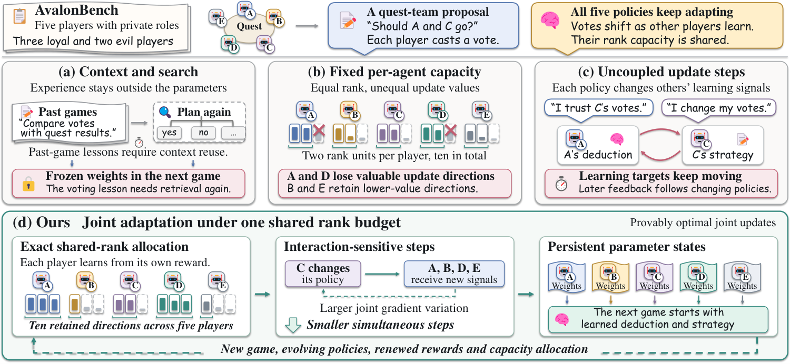

# Joint Test-Time Optimization from Multi-Agent Interaction of Large Language Models

Large language model (LLM) agents increasingly update their parameters during
deployment to adapt to unfamiliar tasks and changing interactions. Existing
test-time training methods improve individual agents, yet simultaneous
adaptation couples their updates through shared computational resources and
evolving learning signals. To address this problem, we formulate joint test-time
optimization over persistent low-rank weights under a shared rank budget.
Specifically, we derive the exact solution of a per-round rank-constrained
proximal problem, which allocates spectral directions across agents and
parameter blocks according to their marginal values. The resulting algorithm
retains parameter states across rounds, reallocates rank as interaction feedback
changes, and adjusts update steps using observed joint gradient variation. We
establish a finite-sample lower bound on the regularized joint game gap and
prove invariance to positive affine reward rescaling. We evaluate the method on
five public multi-agent benchmarks and three LLM backbones, obtaining the
highest mean performance in all 15 settings. At 50 episodes, its normalized gain
exceeds the strongest baseline by 0.93 while using 65% of its computation. The
advantage increases from 0.42 to 1.01 as deployment extends from 10 to 100
episodes, supporting persistent joint adaptation. Code is available at
<https://anonymous.4open.science/r/joint-ttopt-D315>.



## Installation

Use Python 3.10 or later and a PyTorch installation compatible with the
execution hardware.

```bash
python -m venv .venv
source .venv/bin/activate
python -m pip install -e '.[models,test]' \
  --index-url https://pypi.tuna.tsinghua.edu.cn/simple
export HF_ENDPOINT=https://hf-mirror.com
```

## Benchmark and entry preparation

Fetch the pinned benchmark sources, then install the selected environment's
dependencies.

```bash
python -m joint_ttopt fetch --output external
```

[configs/sources.json](configs/sources.json) records upstream revisions.
Environment profiles cover Avalon and Decrypto; the [input
guide](docs/artifacts.md) documents the native interface used by other tasks.

Prepare an entry-training environment configuration, renderer, and declared
fallback return spans as specified in the guide. Entry-training and deployment
use separate task, partner-schedule, and seed identifiers. Collect legal-action
labels from complete base-model trajectories and fit the frozen action head.

```bash
python -m joint_ttopt collect-entry \
  --environment data/entry_environment.yaml --checkpoint Qwen/Qwen3-8B \
  --renderer data/renderer.json --fallback-spans data/return_spans.json \
  --seed 10000 --output data/entry

python -m joint_ttopt train-head --checkpoint Qwen/Qwen3-8B \
  --training-data data/entry/action_labels.jsonl \
  --renderer data/renderer.json --output checkpoints/action_head.npz
```

Collection also writes `data/entry/normalization.json`. Renderer records define
discrete-token mappings, numerical ranges, and visible history. Pin model
revisions when preparing an experiment.

## Calibration

Declare trajectory norm assumptions before collecting paired probes. The
preparation command constructs the corresponding envelopes.

```bash
python -m joint_ttopt prepare-envelopes \
  --specification data/envelope_assumptions.json \
  --output data/gradient_bounds.json

python -m joint_ttopt record-probes \
  --environment configs/avalon.yaml --model Qwen3-8B \
  --head checkpoints/action_head.npz \
  --normalization data/entry/normalization.json \
  --bounds data/gradient_bounds.json --output calibration/probes

python -m joint_ttopt calibrate --manifest calibration/probes/manifest.json \
  --output calibration/reference.json
```

The [calibration reference](docs/artifacts.md#calibration) specifies probe
inputs, validity assumptions, and second-moment records. The default deployment
refreshes calibration at each update round using incumbent weights and a frozen
history baseline.

## Deployment

Run joint adaptation on a configured native environment.

```bash
python -m joint_ttopt deploy --environment configs/avalon.yaml \
  --model Qwen3-8B --head checkpoints/action_head.npz \
  --normalization data/entry/normalization.json \
  --calibration calibration/reference.json \
  --calibration-bounds data/gradient_bounds.json --output results/joint
```

Fast weights persist across episodes. The shared-rank projection reallocates
leading spectral directions under global and per-agent constraints. Add
`--resume results/joint/state.npz` with the original configuration to continue a
checkpoint.

## Evaluation

Export the native Avalon win rate over the specified deployment horizons.

```bash
python -m joint_ttopt metrics results/joint --horizons 10 25 50 \
  --metric win_rate --output results/metrics.jsonl
```

Each requested horizon requires its complete episode prefix. `normalize`
constructs matched Frozen/baseline anchors, and `summarize` aggregates per-seed
normalized records. Their input schemas and native metric names are given in
[docs/artifacts.md](docs/artifacts.md) and
[configs/benchmarks.yaml](configs/benchmarks.yaml).

## Configuration

[configs/paper.yaml](configs/paper.yaml) contains the optimizer, deployment, and
model profiles.

| Setting | Value |
| --- | --- |
| Backbones | Qwen3-8B, Llama-3.1-8B-Instruct, gpt-oss-20b |
| Adapted blocks | 72, 64, 48 respectively |
| Reference rank budgets | 576, 512, 384 respectively |
| Regularization | 0.45 |
| Default deployment | 50 episodes |
| Evaluation horizons | 10, 25, 50, 100 episodes |
| Evaluation seeds | 0–9 |

## Software checks

```bash
CUDA_VISIBLE_DEVICES='' python -m pytest -q
```

Checks cover exact rank allocation, trajectory gradients, calibration, state
restoration, and benchmark interfaces.

## License

The code uses the [MIT License](LICENSE). The paper image retains its published
license.
