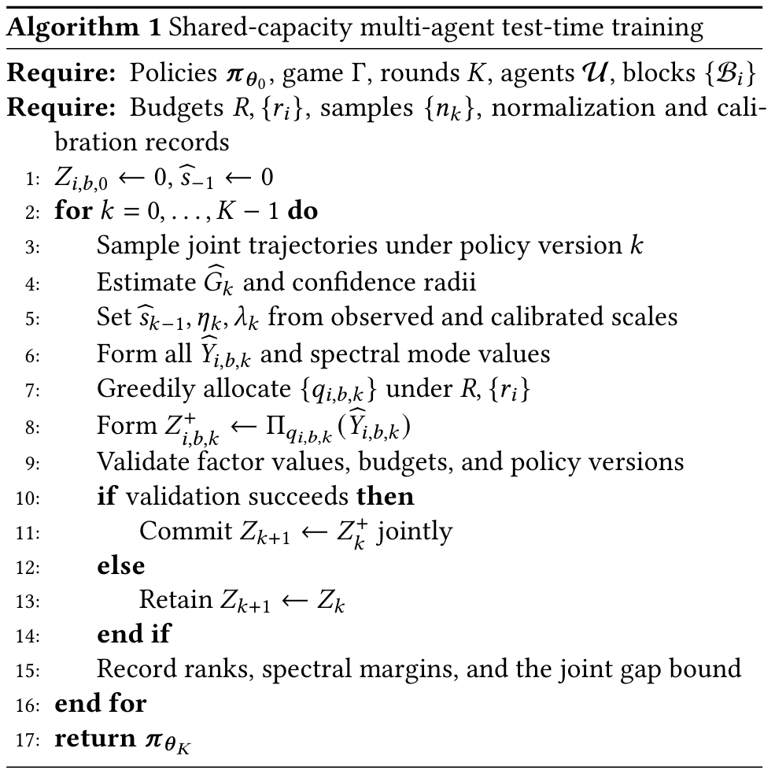
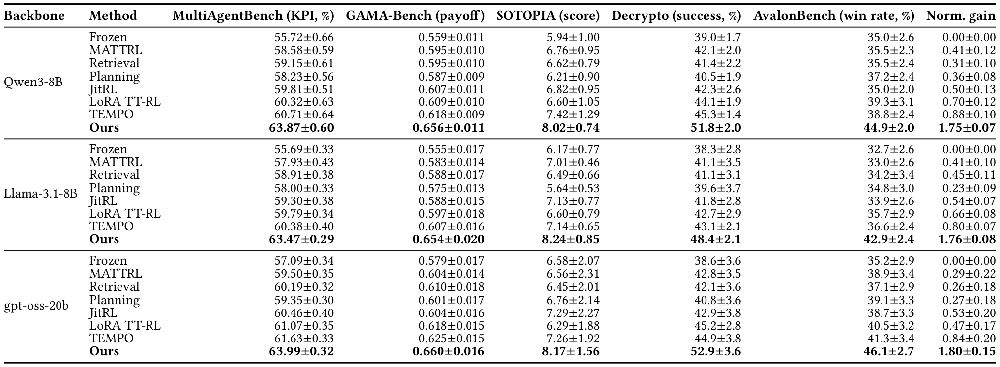
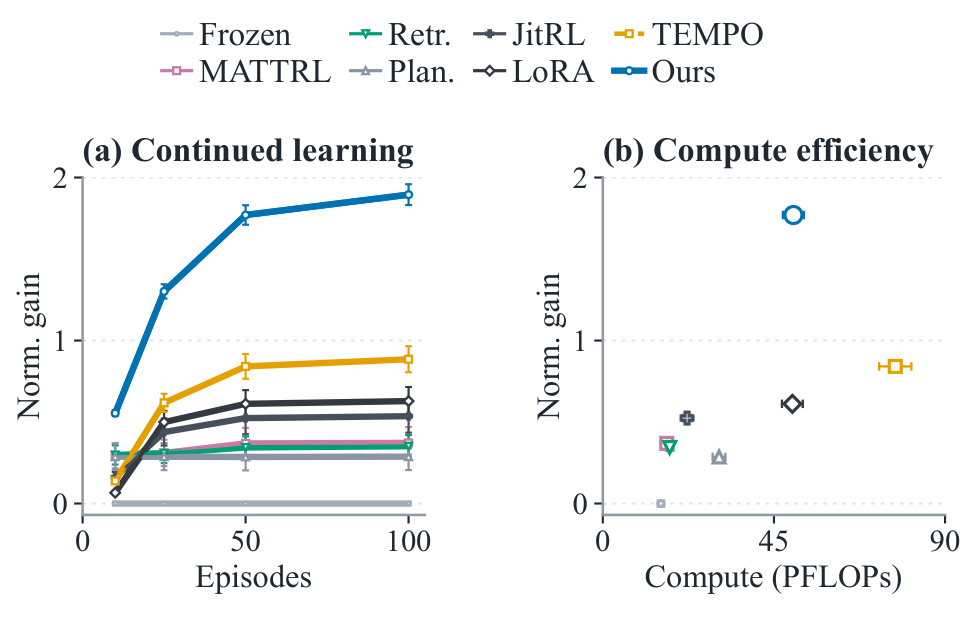

# Joint Test-Time Optimization from Multi-Agent Interaction of Large Language Models

Large language model (LLM) agents increasingly update their parameters during
deployment to adapt to unfamiliar tasks and changing interactions. Existing
test-time training methods improve individual agents, yet simultaneous
adaptation couples their updates through shared computational resources and
evolving learning signals. To address this problem, we formulate joint test-time
optimization over persistent low-rank weights under a shared rank budget.
Specifically, we derive the exact solution of a per-round rank-constrained
proximal problem, which allocates spectral directions across agents and
parameter blocks according to their marginal values. The resulting algorithm
retains parameter states across rounds, reallocates rank as interaction feedback
changes, and adjusts update steps using observed joint gradient variation. We
establish a finite-sample lower bound on the regularized joint game gap and
prove invariance to positive affine reward rescaling. We evaluate the method on
five public multi-agent benchmarks and three LLM backbones, obtaining the
highest mean performance in all 15 settings. At 50 episodes, its normalized gain
exceeds the strongest baseline by 0.93 while using 65% of its computation. The
advantage increases from 0.42 to 1.01 as deployment extends from 10 to 100
episodes, supporting persistent joint adaptation.

## Algorithm Flow

To address this problem, we introduce *joint test-time optimization from multi-agent interaction*. Each agent adapts a frozen LLM through persistent low-rank weights. We formulate their simultaneous update as a proximal optimization problem under a shared rank budget and per-agent caps. Completing the square reduces the problem to joint projection, and singular decomposition assigns a marginal value to each retained direction. The capacity constraints form a laminar family, enabling an exact greedy allocation. Thus, the same optimization step determines both the parameter update and its distribution across participating agents.


**Figure 1.** Joint adaptation in five-player AvalonBench (schematic). (a) Context-dependent experience reuse. (b) Equal per-agent rank budgets. (c) Changing learning signals. (d) Shared spectral allocation, interaction-sensitive steps, and persistent weights. Optimality holds for the per-round proximal objective. Tile heights indicate update values; solid tiles mark retained directions, totaling ten in both allocations. Agent colors identify players, whose roles remain private.

**Persistent parameter states.**

To retain reward-driven adaptation, each agent trains low-rank updates on a frozen pretrained LLM. For adapted linear block $b\in\mathcal B_i$,

$$
W_{i,b,k}=W_{i,b,0}+Z_{i,b,k},\qquad Z_{i,b,0}=0,
\tag{2}
$$

where $\mathcal B_i$ is the adapted-block set, $W_{i,b,0}\in\mathbb R^{m_{i,b}\times p_{i,b}}$ is its pretrained weight, and $Z_{i,b,k}$ is the persistent update. Write $Z_i$ for agent $i$'s blocks and $Z=(Z_1,\ldots,Z_n)$ for their joint state.

We use $\|Z\|_{\mathsf F}^2=\sum_{i,b}\|Z_{i,b}\|_F^2$ across the adapted blocks.

**Exact spectral allocation.**

The agent groups are disjoint and nested within the shared budget, giving a truncated partition matroid. Greedy selection maximizes additive value on this family. Within each block, decreasing singular values and index-based tie breaking ensure that selected modes form a prefix, which corresponds to a feasible truncated SVD. Thus, the optimum over mode subsets also solves the rank-allocation problem.

**Joint secant step.**

To respond to changes in the learning signal after completed updates, set, for $k\geq1$,

$$
\begin{aligned}
\Delta_{k-1}&=Z_k-Z_{k-1},\qquad
\delta_{k-1}=\widehat G_k-\widehat G_{k-1},\\
\widehat s_{k-1}&=\|\delta_{k-1}\|_{\mathsf F}/\|\Delta_{k-1}\|_{\mathsf F},
\end{aligned}
\tag{15}
$$

where $\widehat G_k$ stacks the empirical gradients and $\widehat s_{k-1}$ measures gradient change per unit of joint parameter movement. Initialize $\widehat s_{-1}=0$, and set the ratio to zero when $\|\Delta_{k-1}\|_{\mathsf F}\leq\nu_\Delta$, where $\nu_\Delta\geq0$ is the declared numerical threshold. To calibrate the local scale, paired-seed probes evaluate gradients at $Z^{\mathrm{cal}}\pm h_jv_j$, where $Z^{\mathrm{cal}}$ is the calibration state, $h_j>0$ the radius, and $\|v_j\|_{\mathsf F}=1$. Their central difference is $\widehat\ell_j=\|\widehat G(Z^{\mathrm{cal}}+h_jv_j) -\widehat G(Z^{\mathrm{cal}}-h_jv_j)\|_{\mathsf F}/(2h_j)$. We set $\widehat L_k=\max\{L_{\min},\max_j\widehat\ell_j\}$ with positive floor $L_{\min}$; $\epsilon_{s,k}\geq0$ is the calibrated upper quantile of repeated secant residuals.

Both scales precede the current proposal. Given step margin $\delta_s\in(0,1)$, use

$$
\begin{aligned}
\overline L_k&=\max\{\widehat L_k,\widehat s_{k-1}+\epsilon_{s,k}\},\\
\eta_k&=\frac{1-\delta_s}{\overline L_k},\qquad
\lambda_k=\eta_k^{-1}-\overline L_k.
\end{aligned}
\tag{16}
$$

The step decreases as observed gradient variation grows.

**Persistent spectral update.**

Given a step $\eta_k>0$, each block forms $\widehat Y_{i,b,k}=Z_{i,b,k}+\eta_k\widehat G_{i,b,k}$.

Let $q_{i,b,k}$ denote the selected block rank. The selected ranks give $Z_{i,b,k+1}=\Pi_{q_{i,b,k}}(\widehat Y_{i,b,k})$, where $\Pi_q$ retains the leading $q$ singular directions. A zero-rank assignment releases the block's previous capacity. The committed state enters the next episode through Equation (2).



## Results

### Main Results

**Table 1.** Performance across five benchmarks and three backbones after 50 episodes (mean ± standard deviation over ten paired seeds). All metrics are higher-is-better; bold marks the best mean per backbone. Native metrics complement normalized gain. Paired comparisons and their confidence intervals are detailed in the supplement.



**Joint adaptation improves all benchmark-backbone settings.** Table 1 reports the highest mean for the full method in all 15 settings. Averaged over backbones, MultiAgentBench KPI rises from TEMPO’s 60.9 to 63.8, Decrypto success from 44.4 to 51.0, and AvalonBench win rate from 38.9 to 44.6. The corresponding GAMA-Bench payoff and SOTOPIA score increase from 0.617 to 0.657 and from 7.27 to 8.14.



**Figure 2.** Performance versus (a) horizon and (b) compute at 50 episodes. Bars show seed standard deviations. Retr., Plan., and LoRA denote Retrieval, Planning, and LoRA TT-RL.

**Persistent adaptation benefits from continued interaction.** Figure 2(a) shows the lead over TEMPO growing from 0.42 at ten episodes to 1.01 at 100. Persistent states retain earlier feedback, while repeated allocation responds to changing update values. The common 50-episode normalization anchors keep this comparison on the same scale.

**The gain remains at comparable computation.** Figure 2(b) relates performance to cumulative compute. At 50 episodes, Ours and LoRA TT-RL use 50.12 ± 2.76 and 49.84 ± 2.74 PFLOPs, with a 1.16 difference in normalized gain; Ours uses 65% of TEMPO’s compute.

## Getting Started

### Environment Setup

```bash
conda create -n joint-ttopt python=3.10 -y
conda activate joint-ttopt
pip install -e '.[models]'
```

### Data Preparation

Download the benchmark sources:

```bash
python -m joint_ttopt fetch --output external
```

Install the corresponding environment dependencies using their released instructions.
The paper evaluates MultiAgentBench, GAMA-Bench, SOTOPIA, Decrypto, and AvalonBench.
Configure the benchmark in `data/environment.yaml`. Prepare the action head,
reward normalization, and calibration inputs with the commands in
[input preparation](docs/artifacts.md). The deployment command below uses the
paper settings from `configs/paper.yaml`.

Select one of the three backbones for preparation and deployment:

```bash
MODEL=Qwen3-8B
# MODEL=Llama-3.1-8B
# MODEL=gpt-oss-20b
```

## Training

Collect entry-training trajectories and train the frozen action head:

```bash
python -m joint_ttopt collect-entry --model "${MODEL}" \
  --environment data/entry_environment.yaml --renderer data/renderer.json \
  --fallback-spans data/benchmark_return_spans.json --output data/entry/${MODEL}

python -m joint_ttopt train-head --model "${MODEL}" \
  --training-data data/entry/${MODEL}/action_labels.jsonl \
  --renderer data/renderer.json --output checkpoints/${MODEL}/action_head.npz
```

Record calibration probes using the prepared gradient bounds:

```bash
python -m joint_ttopt record-probes --environment data/environment.yaml \
  --model "${MODEL}" --head checkpoints/${MODEL}/action_head.npz \
  --normalization data/entry/${MODEL}/normalization.json \
  --bounds data/gradient_bounds.json --output calibration/${MODEL}/probes

python -m joint_ttopt calibrate --manifest calibration/${MODEL}/probes/manifest.json \
  --output calibration/${MODEL}/reference.json
```

Run joint test-time training in the configured environment:

```bash
python -m joint_ttopt deploy --environment data/environment.yaml \
  --model "${MODEL}" --head checkpoints/${MODEL}/action_head.npz \
  --normalization data/entry/${MODEL}/normalization.json \
  --calibration calibration/${MODEL}/reference.json \
  --calibration-bounds data/gradient_bounds.json --output results/${MODEL}/joint
```

Add `--resume results/${MODEL}/joint/state.npz` to continue a saved deployment.
Entry collection and probe recording continue when their commands use the same
output directory. Action-head recovery is described in the
[preparation guide](docs/artifacts.md#resuming-training).

## Evaluation

Export the environment's native metric after the 50-episode deployment:

```bash
python -m joint_ttopt metrics results/${MODEL}/joint --horizons 50 \
  --metric METRIC --output results/${MODEL}/metrics.jsonl
```

Set `METRIC` to the native metric returned by the benchmark evaluator.
[Score aggregation](docs/artifacts.md#evaluation) describes normalization across runs.

## License

The code uses the [MIT License](LICENSE).
