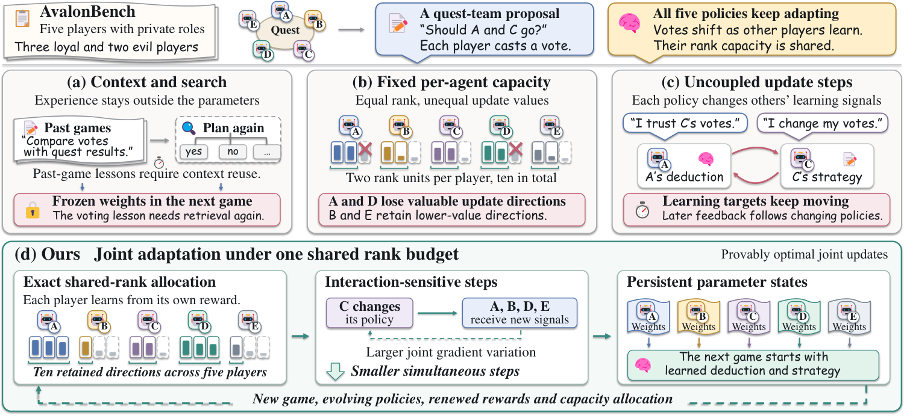

# Joint Test-Time Optimization from Multi-Agent Interaction of Large Language Models

Large language model (LLM) agents increasingly update their parameters during
deployment to adapt to unfamiliar tasks and changing interactions. Existing
test-time training methods improve individual agents, yet simultaneous
adaptation couples their updates through shared computational resources and
evolving learning signals. To address this problem, we formulate joint test-time
optimization over persistent low-rank weights under a shared rank budget.
Specifically, we derive the exact solution of a per-round rank-constrained
proximal problem, which allocates spectral directions across agents and
parameter blocks according to their marginal values. The resulting algorithm
retains parameter states across rounds, reallocates rank as interaction feedback
changes, and adjusts update steps using observed joint gradient variation. We
establish a finite-sample lower bound on the regularized joint game gap and
prove invariance to positive affine reward rescaling. We evaluate the method on
five public multi-agent benchmarks and three LLM backbones, obtaining the
highest mean performance in all 15 settings. At 50 episodes, its normalized gain
exceeds the strongest baseline by 0.93 while using 65% of its computation. The
advantage increases from 0.42 to 1.01 as deployment extends from 10 to 100
episodes, supporting persistent joint adaptation.



## Installation

Use Python 3.10 or later and install PyTorch for your system.

```bash
python -m venv .venv
source .venv/bin/activate
python -m pip install -e '.[models,test]' \
  --index-url https://pypi.tuna.tsinghua.edu.cn/simple
export HF_ENDPOINT=https://hf-mirror.com
```

## Preparation

Download the benchmark sources and install the environment dependencies:

```bash
python -m joint_ttopt fetch --output external
```

The paper evaluates MultiAgentBench, GAMA-Bench, SOTOPIA, Decrypto, and AvalonBench.
Their upstream sources are listed in [configs/sources.json](configs/sources.json).

Before deployment, prepare the action head, reward normalization, and calibration
files using the [preparation guide](docs/artifacts.md). The guide includes the
collection and calibration commands. Model and optimizer settings are in
[configs/paper.yaml](configs/paper.yaml).

## Usage

Create `data/environment.yaml` for your environment using the shared interface
in the [environment guide](docs/artifacts.md#environment-integration), then run:

```bash
python -m joint_ttopt deploy --environment data/environment.yaml \
  --model Qwen3-8B --head checkpoints/action_head.npz \
  --normalization data/entry/normalization.json \
  --calibration calibration/reference.json \
  --calibration-bounds data/gradient_bounds.json --output results/joint
```

## Evaluation

Export the environment's native metric at each deployment horizon:

```bash
python -m joint_ttopt metrics results/joint --horizons 10 25 50 \
  --metric METRIC --output results/metrics.jsonl
```

Set `METRIC` to the evaluator's metric name. The paper's native metrics are listed
in [configs/benchmarks.yaml](configs/benchmarks.yaml). The
[evaluation guide](docs/artifacts.md#evaluation) describes normalization and aggregation.

## Tests

```bash
python -m pytest -q
```

## License

The code uses the [MIT License](LICENSE). The paper image retains its published license.
